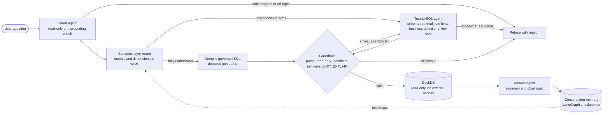
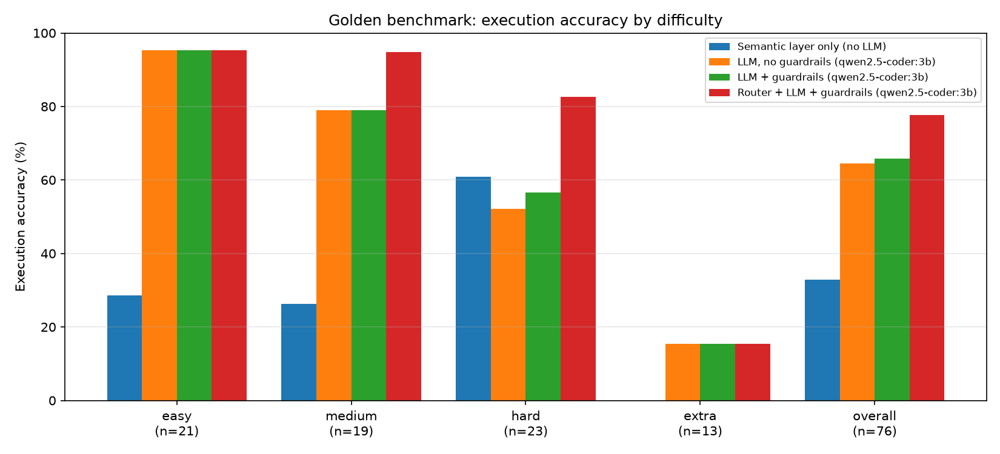
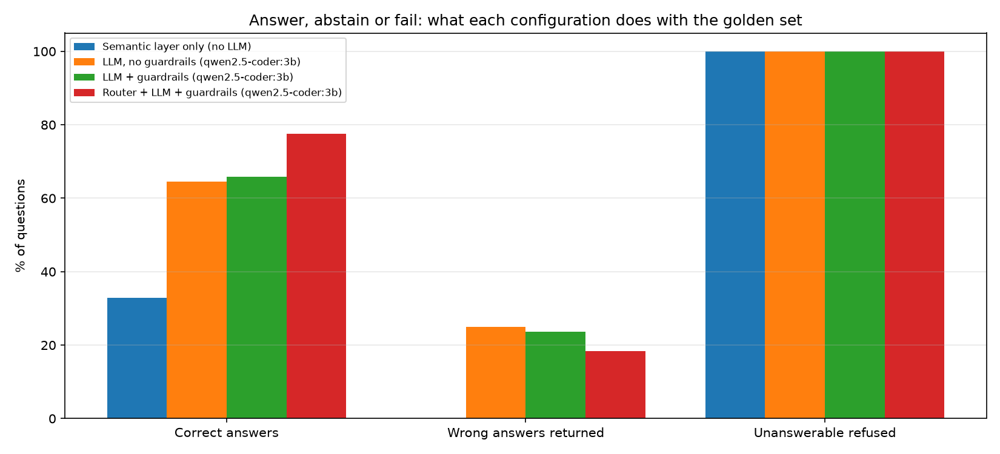

# Analytics Agents & Text-to-SQL

Multi-agent conversational analytics over a multi-join retail warehouse. A **semantic layer router** answers
through governed metrics whenever it fully understands a question, and a **schema-grounded Text-to-SQL agent**
handles the long tail. Every query, governed or generated, passes **guardrails** that block writes, reject
hallucinated tables or columns, enforce declared join paths and dry-run the plan before anything executes. When
no grounded query can be produced, the system refuses instead of guessing.

A golden dataset of 84 questions (76 answerable, from single-table counts to window functions over five-table
joins, plus 8 that the warehouse cannot answer) is scored by **execution accuracy**, not string match. All
numbers below come from runs of `python -m t2s.benchmark` with small open-weight models served locally on CPU.

## Architecture



The workflow is a LangGraph `StateGraph` (`src/t2s/graph.py`). Each node is a small, testable agent:

| Agent | Responsibility |
|---|---|
| Intent | Refuses write requests and questions with no grounding in the schema vocabulary before any model call |
| Semantic layer router | Matches metrics, dimensions, filter values, time ranges and top-N phrasing against `semantic/retail.yaml`; answers only if every content word is understood, otherwise defers with the reason |
| Text-to-SQL | Retrieves the relevant tables, adds the bridge tables needed to join them, renders compact DDL with column notes and valid join keys, the governed metric definitions, the three most similar curated examples and recent conversation turns |
| Guardrails | Validates the candidate and returns precise feedback for a self-correction loop (two retries by default) |
| Executor | Runs on a read-only DuckDB connection with external file and network access disabled and a query timeout |
| Answer | Summarises the result, proposes a bar or line chart and appends the turn to memory |

Follow-ups such as "what about by channel?" or "only Online" are merged with the previous governed query, or
passed to the Text-to-SQL agent together with the previous question and SQL.

## Semantic layer

`semantic/retail.yaml` follows the dbt semantic layer idea: tables with descriptions and synonyms, declared
relationships, governed metrics (`revenue`, `gross_margin`, `average_order_value`, `units_sold`, `order_count`,
`active_customers`, `refund_amount`, `return_count`, `amount_paid`) and dimensions with explicit join paths.
For example `region` resolves through `stores` while `customer_region` resolves through `customers`, so the
two possible routes to `regions` never get mixed. Revenue always excludes cancelled orders, whichever path
answers the question, because the same definitions are injected into the Text-to-SQL prompt.

## Guardrails

| Check | What it stops |
|---|---|
| Single statement that parses with sqlglot | Stacked statements, malformed output |
| Root must be `SELECT` or a set operation; no DML, DDL, `ATTACH`, `COPY`, `PRAGMA`, `SET` anywhere | Writes and session changes |
| Function deny-list (`read_*`, `glob`, `getenv`, table functions, schema-qualified tables) | File system and environment access |
| Every table and column must exist (aliases, CTEs and derived columns are resolved) | Hallucinated identifiers |
| Equality joins on `*_id` columns must be declared relationships or keys referencing the same parent | Joining `orders.order_id = payments.payment_id`-style mistakes |
| Outer `LIMIT` injected or clamped to 1,000 rows | Runaway result sets |
| `EXPLAIN` dry-run in DuckDB | Type errors, ambiguous columns, bad aggregates |
| Read-only connection with `enable_external_access = false` | Defence in depth if a check is ever bypassed |

Failed checks produce feedback such as `unknown columns: ['c.email']; use only columns in the schema`, which
goes back to the generator. After the retry budget the system refuses.

## Benchmark

`benchmark/golden.yaml` holds 84 questions with hand-written gold SQL. Difficulty is derived from the gold
query itself: **easy** (one table), **medium** (two tables), **hard** (three to five tables) and **extra**
(subqueries, CTEs, window functions or set operations). Eight further questions ask for data the warehouse
does not hold, or for a write, and are only correct if the system refuses. The few-shot pool in
`semantic/examples.yaml` is disjoint from the golden questions, and a test enforces that.

A prediction is correct when its result set matches the gold result set: rows compared as multisets, row order
ignored, numbers compared to 8 significant digits, and each gold column mapped to a distinct predicted column, so
an extra `customer_name` next to the requested `customer_id` is not penalised.

Configurations:

* **Semantic layer only**: deterministic router, refuses everything else (no model).
* **LLM, no guardrails**: the first draft is executed as is.
* **LLM + guardrails**: validation, self-correction and refusal, no router.
* **Router + LLM + guardrails**: the full system.

### Results

| Configuration | Model | Exec. accuracy | Easy | Medium | Hard | Extra | Multi-join (3+ tables) | Wrong answers returned | Refused unanswerable | Drafts with hallucinated identifiers |
|---|---|---|---|---|---|---|---|---|---|---|
| Semantic layer only | none | **32.9%** | 28.6% | 26.3% | 60.9% | 0.0% | 48.3% | 0.0% | 100.0% | n/a |
| LLM, no guardrails | qwen2.5-coder:3b | **64.5%** | 95.2% | 79.0% | 52.2% | 15.4% | 44.8% | 25.0% | 100.0% | 12.8% |
| LLM + guardrails | qwen2.5-coder:3b | **65.8%** | 95.2% | 79.0% | 56.5% | 15.4% | 48.3% | 23.7% | 100.0% | 12.8% |
| Router + LLM + guardrails | qwen2.5-coder:3b | **77.6%** | 95.2% | 94.7% | 82.6% | 15.4% | 69.0% | 18.4% | 100.0% | 9.4% |





How to read it:

* **The full system answers 59 of 76 answerable questions correctly (77.6%)** with `qwen2.5-coder:3b`
  (Q4_K_M GGUF through Ollama, temperature 0, CPU only on a shared 8-vCPU machine). On questions that join
  three to five tables it gets 20 of 29 right (69.0%), against 13 of 29 (44.8%) for the same model writing SQL
  on its own.
* **The router is where most of the lift comes from.** It answered 25 questions through governed metrics and
  all 25 matched the gold result, at 0.03 s each with no model call. Medium accuracy rises from 79.0% to 94.7%
  and hard from 56.5% to 82.6%. On its own it covers a third of the set and never returns a wrong answer.
* **Guardrails stop ungrounded SQL from running.** 12.8% of the model's first drafts referenced a table or column
  that does not exist. With guardrails no executed query contained an unknown identifier; without them, one
  flagged draft ran and returned a result. Self-correction rescued 3 questions, and the gain over the raw model
  is small (64.5% to 65.8%) because most remaining errors are valid SQL with the wrong logic.
* **All 8 unanswerable or write requests were refused** in every configuration. Six were stopped by the intent
  agent before any model call, and two (employee salaries, competitor sales) by the model or the guardrails.
* **The weak spot is the extra-hard tier: 2 of 13 (15.4%).** The 3B model tends to drop window functions
  (ranking, running totals, month-over-month change), set logic ("in both 2023 and 2025") and nested
  aggregates. A larger model, more targeted examples or governed metrics for those patterns are the obvious
  next steps. 18.4% of answerable questions still get a wrong but valid answer.

Only the 3B model was run end to end here. The harness takes any OpenAI-compatible endpoint, so other models
can be compared with `T2S_LLM_MODEL=... python -m t2s.benchmark --mode full`.

Per-question records, including the SQL that ran and the route taken, are in `benchmark/results/*.json`.

## Quickstart

```bash
python -m venv .venv && source .venv/bin/activate
pip install -r requirements.txt
python -m t2s.warehouse                      # seeded synthetic warehouse -> data/warehouse.duckdb

# any OpenAI-compatible endpoint works; for example Ollama
ollama pull qwen2.5-coder:3b
export T2S_LLM_BASE_URL=http://localhost:11434/v1 T2S_LLM_MODEL=qwen2.5-coder:3b

t2s-chat                                     # terminal chat; `t2s-chat --semantic-only` needs no model
streamlit run app/streamlit_app.py           # chat UI with SQL, table and chart

python -m t2s.benchmark --mode full          # also: semantic_only, llm_guarded, llm_raw
python -m t2s.report                         # table and charts in docs/
```

A llama.cpp server (`llama-server -m model.gguf --port 8080`, then `T2S_LLM_BASE_URL=http://localhost:8080/v1`),
vLLM or a hosted API (`T2S_LLM_API_KEY`) can be used the same way. Model replies are cached by prompt hash under
`benchmark/results/cache/` so benchmark reruns are reproducible.

Example session:

```text
> Revenue by region in 2024
6 rows. First row: region=Central, revenue=1,245,370.37. (via governed semantic layer)
> what about by channel?
3 rows. First row: channel=In-Store, revenue=2,203,258.64. (via governed semantic layer)
> Which customers never placed an order?
321 rows. First row: customer_id=6, first_name=Jade, last_name=Hale. (via Text-to-SQL)
> delete all orders
I can't answer that reliably: write operations are not permitted; this assistant is read-only
```

## Data

`python -m t2s.warehouse` builds a fully synthetic retail warehouse with a fixed seed: 10 tables (regions,
stores, customers, suppliers, categories, products, orders, order_items, payments, returns), about 25,000
orders, 62,600 order lines, 23,500 payments and 3,400 returns over 2023 to 2025, with skewed customer activity
and product popularity. All names are generated placeholders.

## Project layout

```text
src/t2s/
  warehouse.py    seeded synthetic warehouse
  schema.py       catalog, foreign-key graph, join-path planning, prompt DDL
  semantic.py     governed metrics and dimensions, router, SQL compiler
  retrieval.py    lexical schema retrieval and few-shot selection
  guardrails.py   validation, rewriting and dry-run
  graph.py        LangGraph workflow and conversation memory
  llm.py          OpenAI-compatible client with response cache
  benchmark.py    golden-set harness;  evaluation.py  result matching
  report.py       results table and charts;  cli.py  terminal chat
semantic/         retail.yaml (semantic layer), examples.yaml (few-shot pool)
benchmark/        golden.yaml, results/
app/              Streamlit chat
tests/            guardrails, router, evaluation, workflow, golden-set integrity
```

## Tests and CI

[](https://github.com/sdiazricagno/analytics-agents-text-to-sql/actions/workflows/ci.yml)

`pytest` covers every guardrail (including write attempts against the read-only connection), router coverage
and deferral rules, join-path selection, follow-up merging, the self-correction loop and refusals with a
scripted model, result matching and golden-set integrity.

```bash
ruff check . && ruff format --check . && pytest -q
python -m t2s.benchmark --mode semantic_only   # deterministic, no model needed
```

## Limitations

* Schema retrieval is lexical; embeddings would help with larger schemas and vaguer wording.
* The router is rule-based by design, so its coverage is deliberately narrow: it prefers deferring to guessing.
* The guardrails prove a query is grounded and safe, not that it answers the question. Wrong-but-valid SQL is the
  remaining failure mode and is what the benchmark's wrong-answer rate tracks.

## License

MIT
